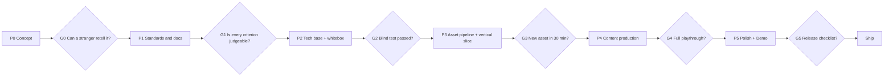

# UE5 Solo 3D Level-Based Game · Production Skill

**Turns "making a game" into 6 stages and 6 executable gates, so an AI agent works to standard and you make only three kinds of decisions.**

[](https://github.com/ChenWenhui816/Personal_Game_Studio_UE/actions/workflows/ci.yml)
[](LICENSE)
[](CHANGELOG.md)

---

## What this is

A complete production workflow for **UE5 single-character, single-player, 3D, level-based** games, written for AI agents (Claude Code / DSH / Codex / Cursor and similar). It is not another game-development tutorial. It is:

- **One deliverable per stage.** If the deliverable has the wrong shape, you do not enter the next stage;
- **One command per gate** (`scripts/gamecheck.py`). Exit code 0 is the only permission to start work;
- **Three decisions for you**: requirements, assets, acceptance. Everything else is delegated;
- **Evidence for every delivery**: screenshot, screen recording, or command output — at least one, attached to a delivery note (交付单) or an acceptance note (验收单).

> Core claim: **a standard you cannot judge is only a wish.** Documents are not the goal; gates are.

## Why you need it

The most dangerous failure for a solo developer plus an AI agent is not "cannot build it" — it is **methodically building the wrong thing**:

|Common failure|How this workflow blocks it|
|---|---|
|A 30-page design doc with no pass/fail criterion|G1: every criterion must be machine-checkable or judgeable by eye in 3 seconds|
|200 assets produced first, then the whitebox proves the core loop does not work|Whitebox (P2) before mass asset production (P3)|
|The agent reports "done" every week, but the build is not what you asked for|Delivery note (交付单) + evidence + weekly screenshot tour|
|Scope keeps growing, so the game never ships|Cut list + capacity accounting + monthly retrospective|
|Store page and ratings are considered only at the end|Store page starts 6 months early; G5 release checklist|

## What's new in v0.5.0

|Area|What changed|
|---|---|
|**Inno Setup installer**|build/installer.iss + build/build_installer.ps1: start menu, uninstall, optional desktop shortcut, per-user install|
|**Code signing hook**|build/sign.ps1 + GitHub Secrets; skipped safely when no certificate|
|**In-app auto update**|Check, download, SHA-256 verify, restart and replace|
|**Change-order wizard**|Create/approve/reject after a stage is frozen; next freeze marks it applied|
|**Section/checklist hierarchy**|H2/H3 outline, checkbox toggles, append section/check item|
|**Evidence wall**|Browse docs/evidence/ images, videos and files|

Guides: docs/桌面版.md, docs/安装包与签名.md.

## What's new in v0.4.0

|Area|What changed|
|---|---|
|**Windows desktop app**|`scripts/console_app.py` + pywebview/WebView2; closing the window stops the local service|
|**PyInstaller build**|`build/desktop.spec`, `build/build_desktop.ps1`, `requirements-desktop.txt`; GitHub Actions builds a Windows zip|
|**Version & update check**|`scripts/version.py` is the single version source; the UI checks GitHub Releases (no silent overwrite)|

Full guide: `docs/桌面版.md`.

## What's new in v0.3.0

|Area|What changed|
|---|---|
|**Local production console**|`python scripts/gameconsole.py serve` opens a local web console for P0–P5, gates, delivery notes and decisions|
|**Project start wizard**|Name + one-sentence idea + folder path → creates the local project and enters the P0 panel|
|**Stage folders & versions**|`stages/00_立项/` … `stages/05_上线/` keep per-stage README, version copies and freeze snapshots|
|**Save / Freeze / Next**|Gates run before freezing; freeze snapshots and locks; next is blocked until frozen|
|**Agent handoff inbox**|Agent submits with `gameconsole.py submit`; the web inbox accepts or returns|

Full guide: `docs/控制台使用指南.md`.

## What's new in v0.2.0

|Area|What changed|
|---|---|
|**Bilingual entry**|`README.md` / `README.en.md` and `SKILL.md` / `SKILL.en.md` are paired; English readers start here, and `references/en/00-overview.md` gives the whole workflow in English|
|**UE Python asset import**|`scripts/ue_import_assets.py` imports a batch through the editor's Python API and sets materials, collision and LOD from the asset manifest instead of by hand|
|**Daily screenshot tour**|`scripts/daily_gallery.py` turns a folder of automated screenshots into one browsable page, so Friday review takes minutes|
|**Keyboard & mouse + gamepad**|Dual input is a first-class requirement, not a P5 afterthought: every action is bound on both devices, every menu is gamepad-navigable, prompts follow the last used device|
|**Change order ↔ asset manifest check**|`gamecheck.py change check` cross-checks change orders (变更单) against `docs/05_资产清单.csv` both ways, so a change that adds, removes or re-specifies assets cannot silently drift|
|**Automated release checks**|`gate release` verifies the `docs/12_Demo上线清单.md` and `docs/13_多语言商店素材清单.md` requirements it can prove from files (dual input, store images, localized copy, trailer), not only that boxes look ticked|
|**Multilingual store assets**|`templates/13_多语言商店素材清单.md` now covers per-language capsule art, screenshots, trailer, subtitles and copy|

## Six stages and six gates



|Stage|Duration|Deliverable|Gate|
|---|---|---|---|
|P0 Concept|1 week|One-page concept doc|A stranger can retell it|
|P1 Standards and docs|2–3 weeks|GDD / Art Bible / Tech Plan / Numbers table|Every criterion is judgeable|
|P2 Tech base + whitebox|3–6 weeks|Runnable project + greybox level|Blind test passed|
|P3 Asset pipeline + vertical slice|6–12 weeks|Style anchor + asset factory + one complete level|A new asset is in-game in 30 minutes|
|P4 Content production|13–22 weeks|All levels, enemies, story|Full playthrough|
|P5 Polish + Demo|23–28 weeks|Performance, localization, store page, Demo|Release checklist all green|

About 28 weeks end to end (conservative; the capacity formula in `references/01-立项.md` gives 16–20 weeks when the agent works 24 h per week). You spend 3–4 hours a week deciding and playtesting.

## Five-minute start

### Option A: visual console (recommended)

```powershell
git clone https://github.com/ChenWenhui816/Personal_Game_Studio_UE.git
cd Personal_Game_Studio_UE
python scripts/gameconsole.py serve
```

Open the printed local URL and follow the project wizard. It creates the project and enters the P0 panel.

### Option B: command line

```bash
# 1. Get the skill (clone or download a release)
git clone https://github.com/ChenWenhui816/Personal_Game_Studio_UE.git

# 2. Scaffold a new game project
python Personal_Game_Studio_UE/scripts/gamecheck.py init --dir D:\games\my-game --name "My Game"

# 3. Fill in the concept doc (8 sections, one page), then pass G0
python Personal_Game_Studio_UE/scripts/gamecheck.py doc check --stage 0 --root D:\games\my-game
```

Hand the project directory to your agent and say one sentence:

> Read `Personal_Game_Studio_UE/SKILL.md` and advance my project stage by stage. Every task ends with a delivery note and evidence.

`init` copies the 14 templates, `gamecheck.py` and a `store/` directory into the project. After that, run `python scripts/gamecheck.py <subcommand> --root .` from the project root; it no longer depends on where the skill is installed.

## Installing into different agents

|Environment|How|
|---|---|
|**DSH**|Put the whole `Personal_Game_Studio_UE/` into your profile skills directory; use the `AGENTS.md` generated by `init` at the game project root (it points at the skill) rather than the repository-level maintenance rules|
|**Claude Code**|Copy to `~/.claude/skills/ue5-solo-game/` (global) or `<project>/.claude/skills/ue5-solo-game/`|
|**Codex / Cursor / Gemini CLI**|Put `AGENTS.md` at the project root and tell the agent to route through `SKILL.md`|
|**Any agent**|It only needs to read Markdown and run commands; the skill is the shell, `scripts/gamecheck.py` is the body|

> Upgrading: `git pull` or download the new Release. To pin a version, check out the matching tag (`git checkout v0.5.0`).

## Command reference

|Command|What it does|When|
|---|---|---|
|`gameconsole.py serve`|Open the local visual console|Day one / daily|
|`gameconsole.py serve --project <path>`|Open an existing project|Existing project|
|`gamecheck.py init --dir . --name "Name"`|Scaffold the project|Day one|
|`gamecheck.py doc check --stage N`|Stage documents are complete|Before entering each stage|
|`gamecheck.py gate spec`|G1 standards frozen|Before work starts, and every Monday|
|`gamecheck.py gate whitebox`|G2 whitebox|End of whitebox|
|`gamecheck.py gate assets`|G3 asset compliance|Before each asset batch enters the project|
|`gamecheck.py gate slice`|G3 vertical slice|End of the slice|
|`gamecheck.py gate content`|G4 content complete|End of content production|
|`gamecheck.py gate release`|G5 release (checklists, dual input, store assets)|Before shipping the Demo|
|`gamecheck.py numbers check`|Jump physics is self-consistent|Every numbers change|
|`gamecheck.py manifest check`|Manifest and directories reconcile|Every day|
|`gamecheck.py change check`|Change orders and the asset manifest reconcile both ways|After every change|
|`ue_import_assets.py`|Batch-import assets into the editor and set materials, collision and LOD from the manifest|Each asset batch (P3 onward)|
|`daily_gallery.py`|Build the daily screenshot tour page from automated captures|Every build day|

Exit codes: `0` pass, `1` fail, `2` usage error. **Read the exit code, not the log.**

`ue_import_assets.py` and `daily_gallery.py` live in the skill's `scripts/` directory; run them from there, or from the project copy if your installed version provides one. Run either with `--help` for the options of the version you installed — the script itself, not this README, is the source of truth for flags.

## Repository layout

```
Personal_Game_Studio_UE/
├─ SKILL.md                  # Skill entry (Chinese): routing + rules + commands
├─ SKILL.en.md               # Skill entry (English)
├─ README.md                 # Human entry (Chinese)
├─ README.en.md              # You are reading this file
├─ AGENTS.md                 # Repository rules auto-read by Codex/DSH and similar
├─ references/               # Detailed workflow, one file per stage
│  ├─ 00-总览与协作.md
│  ├─ 01-立项.md
│  ├─ 02-文档与标准.md
│  ├─ 03-美术资产管线.md
│  ├─ 04-引擎实现.md
│  ├─ 05-打磨与Demo上线.md
│  ├─ 06-风险与反模式.md
│  └─ en/00-overview.md      # English overview of the whole workflow
├─ templates/                # 14 templates you can fill in directly
├─ scripts/
│  ├─ gamecheck.py           # Gate validator (Python standard library, no dependencies)
│  ├─ gameconsole.py         # Local visual console (HTTP + stage state machine)
│  ├─ console_app.py         # Desktop entry (pywebview / WebView2)
│  ├─ version.py             # Single version source + update check
│  ├─ ue_import_assets.py    # UE editor Python: material / collision / LOD import
│  └─ daily_gallery.py       # Daily screenshot tour builder
├─ console_web/              # Console frontend (HTML/CSS/JS, no build step)
├─ build/desktop.spec        # PyInstaller build spec
├─ requirements-desktop.txt  # Desktop build dependencies
├─ tests/                    # Unit tests for validator, console and scripts
├─ docs/
│  ├─ 设计说明.md            # Why the workflow is designed this way
│  ├─ 控制台使用指南.md      # Console: start, save/freeze/next, agent handoff
│  ├─ 桌面版.md              # Desktop build, distribution and update
│  ├─ 安装包与签名.md        # Installer and code signing
│  └─ GitHub发布指南.md      # Release, iteration, installation, FAQ
└─ .github/workflows/ci.yml  # Tests run on every push
```

## Design principles

1. **Judgeable first.** Adjectives never enter a standard. "A 12-colour palette", "≤80k triangles", "2.2 m in 0.4 s" do.
2. **Whitebox first.** No mass asset production before the gameplay is proven.
3. **Evidence-based delivery.** A delivery without a screenshot, recording or command output counts as not done.
4. **Single source of truth.** The standard book holds the rules, the numbers table holds the numbers, everything else references them.
5. **Decision convergence.** You make D1 requirements, D2 assets and D3 acceptance. The agent decides the rest and writes down why.

## Versioning

- Versions follow [SemVer](https://semver.org/). The current version is `v0.5.0`; interfaces and file layout may still change.
- Change history lives in [CHANGELOG.md](CHANGELOG.md).
- How the project is iterated, released and upgraded: see [docs/GitHub发布指南.md](docs/GitHub发布指南.md).
- Console guide: [docs/控制台使用指南.md](docs/控制台使用指南.md).
- When you add or change workflow, you must update in the same pull request: the `SKILL.md` routing, the matching `references/` file, `templates/`, the rules in `scripts/gamecheck.py`, the unit tests, and the CHANGELOG. The English entry files (`README.en.md`, `SKILL.en.md`, `references/en/00-overview.md`) must be kept in step with their Chinese counterparts.

## Scope and boundaries

**Good fit**: 1–3 people, UE5, single-player, one character, 3D levels, 3–8 hours of content, a first small-scale project.

**Not a fit**: multiplayer or online, open world, live-service games, full-time teams of five or more, console certification processes built for large studios.

**What it does not do**: it does not judge whether the game is fun or looks good, it does not pick an art style for you, and it does not guarantee you ship on time. It guarantees that nothing in the process is skipped, that standards are judgeable, and that rework is traceable.

## References and acknowledgements

The methodology draws on these public projects and practices:

- [Donchitos/Claude-Code-Game-Studios](https://github.com/Donchitos/Claude-Code-Game-Studios): studio roles, stage gates, and the `/gate-check` and `/cut` ideas
- [gamedev-skills/awesome-gamedev-agent-skills](https://github.com/gamedev-skills/awesome-gamedev-agent-skills): how asset-pipeline, game-feel and level-design skills are organized
- [Unreal Engine documentation](https://dev.epicgames.com/documentation/unreal-engine): UE5 projects, 3D pipelines, editor Python, MCP
- [Steamworks documentation](https://partner.steamgames.com/doc/home): store pages, Demo, review process
- The "judgeable standards / three decisions / delivery note" practice proven in an earlier 2D hand-drawn workflow

## License

[MIT](LICENSE). UE, Unreal Engine, Steam and Epic Games are trademarks of their respective owners; this repository is not affiliated with Epic Games or Valve.

---

**Languages:** [English](README.en.md) · [中文](README.md)
