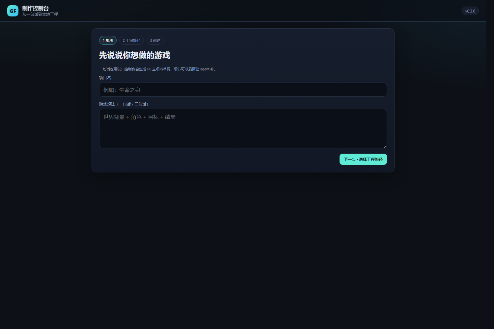
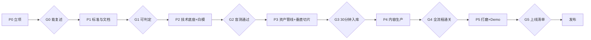

# UE5 单机 3D 闯关游戏 · 制作 Skill

[中文](README.md) ｜ [English](README.en.md)

**把"做游戏"拆成 6 个阶段、6 道可执行闸门，让 AI agent 按标准干活，你只做三类决策。**

[](https://github.com/ChenWenhui816/Personal_Game_Studio_UE/actions/workflows/ci.yml)
[](LICENSE)
[](CHANGELOG.md)

---

## 这是什么

一套面向 **UE5 单角色、单机、3D、关卡制**游戏的完整制作流程 skill，给 AI agent（Claude Code / DSH / Codex / Cursor 等）使用。它不是又一份游戏开发教程，而是：

- **每个阶段只有一个唯一产出物**，形态不对不许进下一阶段；
- **每道闸门都有一条命令**（`scripts/gamecheck.py`），退出码 0 才准开工；
- **用户只做三类决策**：需求、素材、验收，其余全部下放；
- **每次交付必须有证据**：截图 / 录屏 / 命令输出，三选一以上。

> 核心主张：**标准如果不能被判定，就只是愿望。** 文档不是目的，闸门才是。

## 为什么需要它

独立开发者 + AI agent 最危险的失败不是"不会做"，而是**很有条理地做错**：

| 常见死法 | 这套流程怎么挡 |
|---|---|
| 写了 30 页策划，没有一条能判断合格 | G1：每条标准必须机器可查或人眼 3 秒可判 |
| 先量产 200 个资产，白模一跑发现玩法不成立 | 白模（P2）先于资产量产（P3） |
| agent 每周说"完成了"，进游戏不是要的 | 交付单 + 证据 + 每周截图巡览 |
| 范围越做越大，永远发不了 | 砍功能清单 + 产能核算 + 月度复盘 |
| 做完才想上线，商店页/资质来不及 | 商店页提前 6 个月，G5 上线清单 |

## v0.5.0 新增：安装包、自动更新与控制台增强

| 能力 | 入口 | 说明 |
|---|---|---|
| Inno Setup 安装包 | `build/installer.iss` + `build/build_installer.ps1` | 开始菜单、卸载、可选桌面快捷方式，安装到用户目录 |
| 代码签名钩子 | `build/sign.ps1` + GitHub Secrets | 有证书则签 exe/setup；无证书自动跳过，不阻塞构建 |
| App 自动更新 | 控制台「检查更新」→ 下载 → 重启替换 | 校验大小/SHA-256，退出后 PowerShell 替换并重启 |
| 变更单向导 | 控制台「变更单」 | 冻结后走变更单解锁；再次冻结自动标记生效 |
| 章节/检查项层级 | 阶段右侧「章节」面板 | 解析 H2/H3 与 checkbox，可跳转、勾选、追加 |
| 证据墙 | 控制台「证据墙」 | 读取 `docs/evidence/` 的截图/录屏/文件 |

安装包与签名：`docs/安装包与签名.md`；桌面版：`docs/桌面版.md`。

## v0.4.0 新增：桌面版

- `scripts/console_app.py`：pywebview/WebView2 桌面窗口；关闭窗口停止本地服务。
- PyInstaller 打包：`build/desktop.spec` + `build/build_desktop.ps1`，输出 `dist/Personal_Game_Studio_UE/`。
- 版本统一在 `scripts/version.py`；UI「检查更新」查 GitHub Releases，只提示不自动覆盖。
- 桌面首次运行把 skill 释放到 `%LOCALAPPDATA%\Personal_Game_Studio_UE\skill\<版本>`。
- 构建与更新说明：`docs/桌面版.md`。

## v0.3.0 新增：本地制作控制台

| 能力 | 入口 | 解决什么 |
|---|---|---|
| 项目启动向导 | `python scripts/gameconsole.py serve` | 填一句想法 + 选工程目录，自动创建本地工程并进入 P0 |
| 六阶段可视化 | 浏览器 `http://127.0.0.1:8765/` | P0–P5 状态、闸门红绿灯、当前阶段一眼看清 |
| 环节工作台 | 文档树 + Markdown 编辑/预览 | 不改文件位置，网页直接改 `docs/` |
| 保存 / 冻结 / 下一步 | 状态机按钮 | 冻结前跑闸门、生成快照、锁定文档；未冻结不能下一步 |
| 每环节本地文件夹 | `stages/00_立项/` … `stages/05_上线/` | 版本副本、冻结快照、README 可直接在资源管理器打开 |
| agent 交接 | `gameconsole.py submit` + 收件箱 | agent 交付单/证据/退回原因有地方放 |

完整说明见 `docs/控制台使用指南.md`。



## v0.2.0 新增了什么

| 能力 | 入口 | 解决什么 |
|---|---|---|
| 中英双语 | `README.en.md` / `SKILL.en.md` / `references/en/00-overview.md` | 英文协作者/agent 能直接读入口 |
| UE Python 资产导入 | `scripts/ue_import_assets.py` | 按资产清单批量导入，自动设材质/碰撞/LOD |
| 键鼠 + 手柄双输入 | GDD/技术方案/测试记录 + `gate release` | 两套设备都能通关，热切换与重映射有验收 |
| 每日截图巡览 | `scripts/daily_gallery.py` | 每天 5 分钟看 12 张图，发现跑偏 |
| 变更单 ↔ 资产清单联动 | `gamecheck.py change check` | 变更可追溯，清单引用不悬空 |
| 发布检查自动化 | `gamecheck.py gate release --store-dir store` | 清单/双输入/商店素材/变更对账一次跑完 |
| 多语言商店素材清单 | `templates/13_多语言商店素材清单.md` | 中英商店文案、截图、胶囊图、字幕逐项判定 |

## 六阶段与六道闸门



| 阶段 | 周期 | 产出 | 闸门 |
|---|---|---|---|
| P0 立项 | 1 周 | 一页纸立项书 | 陌生人能复述 |
| P1 标准与文档 | 2–3 周 | GDD / 美术圣经 / 技术方案 / 数值表 | 每条标准可判定 |
| P2 技术底座 + 白模 | 3–6 周 | 可运行工程 + 灰盒关卡 | 盲测通过 |
| P3 资产管线 + 垂直切片 | 6–12 周 | 风格锚点 + 资产工厂 + 1 关完整流程 | 新资产 30 分钟入库 |
| P4 内容生产 | 13–22 周 | 全部关卡/敌人/剧情 | 全流程通关 |
| P5 打磨 + Demo 上线 | 23–28 周 | 性能/本地化/商店页/Demo | 上线清单全绿 |

全程约 28 周（保守排期；按 `references/01-立项.md` 的公式核算，agent 每周 24 h 时约 16–20 周）。你每周投入 3–4 小时，只做决策和试玩。

## 5 分钟上手

### 方式 A：可视化控制台（推荐）

```powershell
git clone https://github.com/ChenWenhui816/Personal_Game_Studio_UE.git
cd Personal_Game_Studio_UE
python scripts/gameconsole.py serve
```

浏览器打开日志里的地址（默认 <http://127.0.0.1:8765/>），按“新建项目”向导填写想法、选工程目录，创建后自动进入 P0 面板。

### 方式 B：命令行

```bash
# 1. 拿到 skill（clone 或下载 release）
git clone https://github.com/ChenWenhui816/Personal_Game_Studio_UE.git

# 2. 生成一个新游戏项目骨架
python Personal_Game_Studio_UE/scripts/gamecheck.py init --dir D:\games\my-game --name "我的游戏"

# 3. 填立项书（8 节，一页纸），然后过 G0
python Personal_Game_Studio_UE/scripts/gamecheck.py doc check --stage 0 --root D:\games\my-game
```

把项目目录交给 agent，并说一句：

> 读 `Personal_Game_Studio_UE/SKILL.md`，按阶段推进我的项目；每次任务交交付单并附证据。

`init` 会把 14 份模板、`scripts/gamecheck.py` 与 `store/` 目录一起复制进项目。之后在项目根直接用 `python scripts/gamecheck.py <子命令> --root .` 即可，不依赖 skill 的安装路径。

## 安装到不同 agent

| 环境 | 做法 |
|---|---|
| **DSH** | 把整个 `Personal_Game_Studio_UE/` 放进你的 profile 技能目录；游戏项目根使用 `init` 生成的 `AGENTS.md`（已指向 skill），不要用仓库根的维护规则 |
| **Claude Code** | 复制到 `~/.claude/skills/ue5-solo-game/`（全局）或 `<项目>/.claude/skills/ue5-solo-game/` |
| **Codex / Cursor / Gemini CLI** | 把 `AGENTS.md` 放到项目根；让 agent 读 `SKILL.md` 路由 |
| **任意 agent** | 只要会读 Markdown、会执行命令即可；skill 是外壳，`scripts/gamecheck.py` 是主体 |

> 升级：`git pull` 或重新下载 Release；想锁版本就切到对应 tag（`git checkout v0.5.0`）。

## 命令速查

| 命令 | 作用 | 何时 |
|---|---|---|
| `gameconsole.py serve` | 启动本地可视化控制台 | 第一天 / 每天 |
| `gameconsole.py serve --project <路径>` | 打开已有项目 | 已有工程 |
| `gamecheck.py init --dir . --name "名"` | 生成项目骨架（控制台会调用） | 第一天 |
| `gamecheck.py doc check --stage N` | 阶段文档齐备 | 每阶段进入前 |
| `gamecheck.py gate spec` | G1 标准冻结 | 开工前、每周一 |
| `gamecheck.py gate whitebox` | G2 白模 | 白模结束 |
| `gamecheck.py gate assets` | G3 资产合规 | 每批资产入库前 |
| `gamecheck.py gate slice` | G3 垂直切片 | 切片结束 |
| `gamecheck.py gate content` | G4 内容完成 | 内容生产结束 |
| `gamecheck.py gate release` | G5 上线（12/13 清单+双输入+商店素材） | 发 Demo 前 |
| `gamecheck.py change check` | 变更单↔资产清单对账 | 每次变更后 |
| `ue_import_assets.py --dry-run` | 资产导入预检（材质/碰撞/LOD） | 每批导入前 |
| `daily_gallery.py --src ...` | 每日截图巡览 | 每天 5 分钟 |
| `gamecheck.py numbers check` | 跳跃物理自洽 | 每次改数值 |
| `gamecheck.py manifest check` | 清单与目录对账 | 每天 |

退出码：`0` 通过，`1` 不通过，`2` 用法错误。**读退出码，不要读日志猜。**

## 目录结构

```
Personal_Game_Studio_UE/
├─ SKILL.md                  # 技能入口：阶段路由 + 铁律 + 命令
├─ README.md                 # 你正在读的文件
├─ AGENTS.md                 # 给 Codex/DSH 等自动读取的仓库规则
├─ references/               # 六个阶段的详细流程
│  ├─ 00-总览与协作.md
│  ├─ 01-立项.md
│  ├─ 02-文档与标准.md
│  ├─ 03-美术资产管线.md
│  ├─ 04-引擎实现.md
│  ├─ 05-打磨与Demo上线.md
│  └─ 06-风险与反模式.md
├─ README.en.md              # English README
├─ SKILL.en.md               # English skill entry
├─ references/en/            # English overview（主 references 仍为中文）
├─ templates/                # 14 份可直接填写的模板（含 13 多语言商店素材清单）
├─ scripts/
│  ├─ gamecheck.py           # 闸门校验器（标准库，无依赖）
│  ├─ gameconsole.py         # 本地可视化控制台（HTTP + 状态机）
│  ├─ console_app.py         # 桌面版入口（pywebview/WebView2）
│  ├─ version.py             # 单一版本源 + 更新检查
│  ├─ ue_import_assets.py    # UE 资产导入（材质/碰撞/LOD）
│  └─ daily_gallery.py       # 每日截图巡览生成器
├─ console_web/              # 控制台前端（HTML/CSS/JS，无构建）
├─ build/desktop.spec        # PyInstaller 打包配置
├─ build/build_desktop.ps1   # Windows 一键构建
├─ build/installer.iss       # Inno Setup 安装包
├─ build/sign.ps1            # 可选代码签名
├─ requirements-desktop.txt  # 桌面版构建依赖
├─ tests/                    # 校验器与脚本单元测试
├─ docs/
│  ├─ 设计说明.md            # 这套流程为什么这样设计
│  ├─ 维护规范.md            # 章节约定/改动联动清单
│  ├─ 控制台使用指南.md      # 控制台启动、保存/冻结/下一步、交接
│  ├─ 桌面版.md              # 桌面版构建、分发与更新
│  ├─ 安装包与签名.md        # Inno Setup 与代码签名
│  ├─ UE资产导入脚本.md      # 导入脚本使用说明
│  ├─ 每日截图巡览.md        # 巡览生成器使用说明
│  └─ GitHub发布指南.md      # 发布、迭代、安装、FAQ
└─ .github/workflows/ci.yml  # 推送自动跑测试
```

## 设计原则

1. **可判定优先**：形容词不进标准书。"色板 12 色""面数 ≤80k""跳跃 2.2m/0.4s"才进。
2. **白模先行**：玩法没验证，不做量产资产。
3. **证据交付**：没有截图/录屏/命令输出的交付等于没做。
4. **唯一真相源**：标准书是规则，数值表是数字，其余全部引用。
5. **决策收敛**：你只做 D1 需求 / D2 素材 / D3 验收，其余 agent 决策并写理由。

## 版本与迭代

- 版本遵循 [SemVer](https://semver.org/lang/zh-CN/)；当前 `v0.5.0`，接口与文件结构可能调整。
- 变更记录见 [CHANGELOG.md](CHANGELOG.md)。
- 迭代方式、发布流程、如何让使用者升级：见 [docs/GitHub发布指南.md](docs/GitHub发布指南.md)。
- 新增/修改流程时，必须同步更新：`SKILL.md` 路由、对应 `references/`、`templates/`、`scripts/gamecheck.py` 的规则、单元测试与 CHANGELOG。

## 适用与边界

**适合**：1–3 人、UE5、单机、单角色、3D 关卡制、3–8 小时内容、首作小品级项目。

**不适合**：多人/联网、开放世界、服务型游戏、5 人以上全职团队、需要主机认证的大厂流程。

**它不做什么**：不判断"好不好玩、好不好看"，不替你选美术风格，不保证按时上线。它只保证流程不漏项、标准可判定、返工可追踪。

## 参考与致谢

本流程的方法论受以下公开项目与实践启发：

- [Donchitos/Claude-Code-Game-Studios](https://github.com/Donchitos/Claude-Code-Game-Studios)：工作室职责、阶段闸门、`/gate-check` 与 `/cut` 的思路
- [gamedev-skills/awesome-gamedev-agent-skills](https://github.com/gamedev-skills/awesome-gamedev-agent-skills)：资产管线、game-feel、关卡设计的技能组织方式
- [Unreal Engine 文档](https://dev.epicgames.com/documentation/unreal-engine)：UE5 工程、Paper2D/3D 管线、MCP
- [Steamworks 文档](https://partner.steamgames.com/doc/home)：商店页、Demo、审核流程
- 以及本地上一版 2D 手绘工作流中经过验证的"标准可判定 / 三类决策 / 交付单"实践

## 许可

[MIT](LICENSE)。UE、Unreal Engine、Steam、Epic Games 等名称与商标归各自所有者；本仓库与 Epic Games、Valve 无隶属关系。
