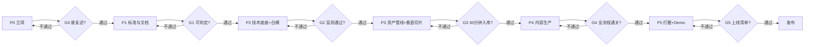
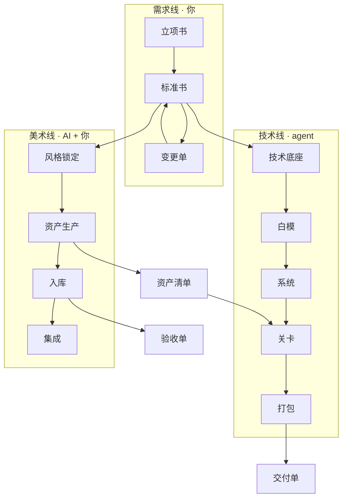

# 00 总览与协作：这套流程怎么运转

> 适用阶段：8 管线治理总览（pipeline 细则见 docs/管线） ｜ 何时加载：接手新项目、不确定下一步、需要向人解释整体设计时 ｜ 上游：无 ｜ 下游：docs/管线/00 至 07
> 注：本文件保留早期 6 阶段治理模型；v0.7 起以 docs/管线 的 8 管线为准。

## 这套流程解决什么问题

独立开发者 + AI agent 最大的风险不是"不会做"，而是**很有条理地做错**。三种典型死法：

| 死法 | 表现 | 根因 |
|---|---|---|
| 文档死 | 写了 30 页策划，没有一条能判定合格/不合格 | 标准是形容词，不是判据 |
| 资产死 | 先量产 200 个资产，白模一跑发现玩法不成立 | 量产早于验证 |
| 自嗨死 | agent 每周交付"已完成"，进游戏一看不是要的东西 | 交付没有证据，偏离没有记录 |

这套流程只用三个机制对冲：

1. **每个阶段只有一个唯一产出物**，产出物形态不对，不许进下一阶段。
2. **每个阶段出口有一道可判定的闸门**（G0–G5），闸门不靠感觉，靠命令 + 人眼 3 秒判定。
3. **用户只做三类决策**（需求 / 素材 / 验收），其余全部下放，但下放的前提是标准书冻结。

> 一句话：**把"做游戏"变成"过闸门"。** 文档不是目的，闸门才是。

## 适用与不适用

| 适用 | 不适用 |
|---|---|
| 1–3 人，含 1 名非程序出身的负责人 | 5 人以上全职团队（需要更重的制作管理） |
| UE5（5.8+），单机，Windows 优先 | 联网、多人、服务型游戏 |
| 单角色、3D、关卡制、3–8 小时内容 | 开放世界、程序化生成、沙盒 |
| AI 生成美术 + agent 写代码/搭关卡 | 需要主机认证/大厂发行流程的项目 |
| 首作按"小品"规模（3–5 关，12–16 周生产 + 上线缓冲） | 商业级体量（20 关以上） |

不适用不代表不能改，代表改之前先读完 `06-风险与反模式.md` 的"规模失控"一节。

## 六个阶段与六道闸门

| 阶段 | 周次 | 主导 | 核心产出 | 闸门 | 你的投入 |
|---|---|---|---|---|---|
| **P0 立项** | 第 1 周 | 你 + agent | `docs/00_立项书.md` | G0 陌生人能复述 | 2 h |
| **P1 标准与文档** | 第 2–3 周 | 你 + agent | GDD / 美术圣经 / 技术方案 / 关卡总表 / 资产清单 / 数值表 | G1 每条标准可判定 | 4 h |
| **P2 技术底座 + 白模** | 第 3–6 周 | agent | 可运行工程、灰盒关卡、手感参数、盲测记录 | G2 盲测通过 | 2 h |
| **P3 风格锁定 + 资产管线 + 垂直切片** | 第 6–12 周 | agent + 你 | 风格锚点、资产工厂、1 关完整流程 + Boss + UI + 音效 | G3 新资产 30 分钟入库 | 8 h |
| **P4 内容生产** | 第 13–22 周 | agent | 全部关卡、敌人、剧情、收集 | G4 全流程通关 | 12 h |
| **P5 打磨 + Demo 上线** | 第 23–28 周 | agent + 你 | 性能、本地化、商店页、Demo | G5 上线清单 | 8 h |



上面的周次是"agent 每周 12–16 h"的保守排期（约 7 个月）。按 `01-立项.md` 的核算公式，agent 每周 24 h 时约 16–20 周；以算出的为准，本表只作上限提醒。第一次做，把 P4 砍到 3 关，先拿到"完整走完一遍"的经验。

## 相对原始设想的四个修正

原始设想（用户 docx）的顺序是：立项 → 前期筹备（概念/美术/技术文档）→ 中期筹备（风格锁定 → 资产生产 → 入库 → 集成）→ 中期引擎实现（导入素材 → 做关卡 → 光影 → 打包）→ Demo 上线。方向对，但有四处会让新手翻车，本流程做了修正：

| # | 原始写法 | 修正 | 原因 |
|---|---|---|---|
| 1 | 资产生产在引擎实现之前 | 白模（P2）先于资产量产（P3） | 玩法没验证就量产，100 个资产会跟着一个不好玩的核心循环一起废掉。前期只做**概念设计**，不做量产资产 |
| 2 | "每一项提交审核，确认后进行下一项" | 前 20 个逐张审，之后**批次 + 抽检 20%** | 逐项审核会把 3 小时/周的你拖死；批次抽检能把质量守住 |
| 3 | 做完游戏再想 Demo 上线 | 商店页提前 6 个月建，Demo 在垂直切片后就发 | 愿望单需要时间积累；Demo 是拿到真实反馈的最便宜方式 |
| 4 | 只有流程，没有成本/变更/证据 | 增加产能核算、变更单、交付单/验收单、数值单一来源 | agent 会"自洽地跑偏"，没有证据和变更记录就无法纠偏 |

## 你只做三类决策

| 编号 | 决策 | 你在决定什么 | 频率 | 单次 | 拿到的东西 |
|---|---|---|---|---|---|
| **D1 需求** | 做什么、砍什么 | 每月 ≤2 次 | 30 min | 立项书 / 变更单（带 2–3 个选项和影响评估） |
| **D2 素材** | 从 A/B/C 三版选一版 | 每周 1 次 | 45 min | 3 组候选 + 对比图 + 一致性评分 |
| **D3 验收** | 资产/系统能否进游戏 | 每周 1 次 | 30 min | 验收单（逐项判定 + 偏差数字） |

**其余全部下放**：技术方案、代码、关卡搭建、资产生产、切图/导入、测试、打包、文档维护。

三条纪律比决策更重要：

1. **不要中途进编辑器手动改。** 你的手改会和 agent 的改动冲突且不可追踪。想改什么，写变更单。
2. **不要逐行看代码。** 用"游戏里能否看到正确行为"验收。
3. **不要在聊天里口头改需求。** 口头需求会丢，一周后 agent 会做出你没要的东西。一律进变更单。

## 四条流水线与四个接口



三条线并行，但只有四个东西需要你签字：

| 接口 | 文件 | 作用 | 谁维护 |
|---|---|---|---|
| ① 标准书 | `docs/01`–`docs/03` | 唯一的规则与数值真相源 | 你冻结，agent 提案 |
| ② 资产清单 | `docs/05_资产清单.csv` | 美术与技术的对接表 | agent 维护，你审 |
| ③ 交付单 | `docs/07_交付单/` | agent 向你汇报的唯一格式 | agent |
| ④ 验收单 | `docs/08_验收单/` | 你向美术/系统线下的结论 | 你（或你授权的 agent 代填，你签字） |

标准书之外的一切争论，回到标准书仲裁。这是唯一能防止 agent"自洽跑偏"的机制。

## 每周 3–4 小时怎么花

| 时段 | 内容 | 时长 |
|---|---|---|
| 周一 | 批本周任务卡（≤5 张，D1） | 15 min |
| 周三 | 素材决策（D2）：看 3 组候选，选，写一句理由 | 45 min |
| 周五 | 截图巡览 + 交付单验收（D3）+ 下周目标 | 45–60 min |
| 每月末 | 复盘 + 范围调整 + 砍功能清单 | 60 min |

**为什么必须每周出现**：停两周，agent 大概率已经按它自己的理解跑偏两周。每周 3 小时是这套系统里唯一的纠偏机制。

## 文档体系

| 层次 | 文件 | 性质 | 谁能改 |
|---|---|---|---|
| 宪法 | `01_游戏设计文档` / `02_美术圣经` / `03_技术方案` | 冻结后只读 | 只有变更单能改 |
| 数值 | `06_数值表.csv` | 唯一数值源 | 只有变更单能改 |
| 计划 | `04_关卡设计/`、`12_Demo上线清单`、`13_多语言商店素材清单` | 随进度更新 | agent 改，你审 |
| 记录 | `07_交付单/`、`08_验收单/`、`09_变更单/`、`10_测试记录`、`11_周报/` | 只追加，不改历史 | agent 写 |

三条硬规则：

1. **数值只活在一个地方**：所有数字写进 `06_数值表.csv`，文档只引用不重复。文档写"跳跃高度见 06 表"，不写"跳跃高度 2.2m"。
2. **文档与实现冲突时改实现**，不改书；要改书必须走变更单。
3. **每份交付必须有证据**：截图、录屏、命令输出三选一以上。没有证据的交付单直接退回。

## 闸门总表

| 闸门 | 判定 | 命令 | 不通过怎么办 |
|---|---|---|---|
| G0 | 陌生人读完能复述；核心循环闭环；规模数字自洽；不做清单 ≥5 条 | 人工 + `doc check --stage 0` | 回 P0 补立项书 |
| G1 | 每条标准机器可查或人眼 3 秒可判；跳跃数值自洽；资产清单可核对；技术方案有性能预算 | `gate spec` | 回 P1 删形容词、补数值 |
| G2 | 3 名盲测者 ≥2 人主动重复核心动作；无人卡在前 2 个检查点；灰盒 60fps | `gate whitebox` + 录屏 | 回 P2 调手感/改关卡 |
| G3 | 未见过的资产 30 分钟完成入库→验收→进关卡；风格不漂；垂直切片 60 秒可看懂 | `gate assets` + `gate slice` | 回 P3 修管线 |
| G4 | 主菜单→通关无阻断 bug；每关有记忆点；存档/设置可用；内容与 GDD 一致 | `gate content` | 回 P4 修内容 |
| G5 | 性能达标；12/13 清单全勾；键鼠+手柄双输入验证；中英商店素材齐备；变更单与资产清单对账；Demo 可下载 | `gate release` + `change check` | 回 P5 补清单/素材 |

脚本只能验证**确定性证据是否齐备**，不能验证"好不好玩、好不好看"。后者永远是你的 D2/D3 决策。

## 项目目录

```
<项目根>/
├─ docs/                      # 所有文档，见 02-文档与标准
├─ art/
│  ├─ Source/                 # blend/psd 源工程（可选入库）
│  ├─ Export/                 # fbx/png/wav 导出件
│  └─ Inbox/                  # 待导入
├─ assets/                    # 已登记、可导入 UE 的最终资产
├─ game/                      # UE 工程
├─ stages/                    # 每个环节的本地文件夹：README + versions/ + frozen/
│  ├─ 00_立项/ … 05_上线/
├─ .gameconsole/              # 控制台状态、审计、版本索引、agent 收件箱
├─ store/                     # 商店素材：胶囊图/双语截图/文案/预告片/字幕
├─ gallery/                   # 每日截图巡览输出（不入库）
├─ gamecheck.json             # 项目配置
└─ AGENTS.md                  # 给 agent 的项目规则
```

**可视化控制台（v0.7.3）**：`python scripts/gameconsole.py serve` 启动本地网页，按阶段推进、保存 / 冻结 / 下一步；`stages/` 是每个环节的本地版本与快照，`docs/` 仍是唯一真相源。详见 `docs/控制台使用指南.md`。

## 角色与权限

| 角色 | 允许 | 禁止 |
|---|---|---|
| 你 | 决策、验收、试玩、改标准书（走变更单） | 手改编辑器、逐行改代码、口头改需求 |
| agent | 写代码、搭白模、做关卡、生产与导入资产、写文档、跑测试 | 直接改 main、删源资产、升引擎版本、无证据交付、绕过闸门 |
| MCP | 读工程、改编辑器、跑脚本 | 远程访问、并行连同一编辑器、批量重命名（改用 Python） |

## 成本模型

排期前先算三笔账，任何一笔超了就先砍范围：

```
内容时长 = 关卡数 × 单关分钟数              # 目标 3–5 小时
美术工时 = 资产件数 × 单件工时 × 1.3       # 1.3 是返工系数
可用周数 = (总预算小时 × 0.6) ÷ 每周小时   # 0.6 是留白系数
```

首作建议上限：3 关、5 种敌人、1 个 Boss、30–50 条音效、60–120 个资产件（网格 + 贴图件；动画帧、材质等引擎侧资源另计）。超过这个数，先做完一个完整的"小品"再说。

## 检查清单

- [ ] 项目根有 `gamecheck.json` 与 `docs/` 目录
- [ ] 当前阶段明确，且上一道闸门命令退出码为 0
- [ ] 标准书已冻结（冻结日期、版本号、变更方式已写）
- [ ] 数值只在 `06_数值表.csv` 出现一次
- [ ] 本周任务 ≤5 张，每张有验收标准
- [ ] 每份交付单都有证据链接/路径
- [ ] 资产清单与 `assets/` 目录双向对齐
- [ ] 变更单记录了本周所有范围/数值/风格改动
- [ ] `change check` 通过（变更单↔资产清单双向对账）
- [ ] 周报已写：完成/阻塞/下周/待决策（≤3）
