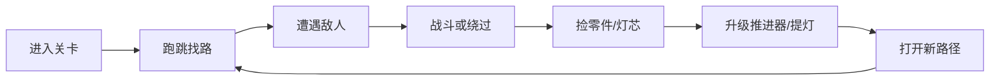

# P0 立项：从模糊想法到一页纸立项书

> 适用阶段：P0（第 1 周） ｜ 何时加载：用户说“我想做一个 UE5 3D 闯关游戏”，但还说不清角色、目标、循环时 ｜ 上游：无（只需用户的一句话想法） ｜ 下游：`references/02-文档与标准.md`（P1 四本标准书）

## 这一阶段要回答的问题

1. 玩家在这场游戏里重复按的 3 个键是什么？
2. 这 3 个键在哪个瞬间爽，那一秒的画面里有什么？
3. 一共几关、每关几分钟、总共几小时？
4. 这次明确不做什么，至少 5 条，每条能说出为什么砍？
5. 谁在什么设备上玩，一次坐多久？
6. 按现在的人力和每周 3–4 小时，这些内容算下来做得完吗？

## 输入

| 输入 | 最低要求 | 缺了会怎样 |
|---|---|---|
| 用户的一句话想法 | 能说出“在某个世界、某个角色做某件事” | 无法启动，先做 15 分钟自由联想 |
| 参考图或参考游戏 | ≥2 个用户真的玩过/看过的作品 | 美术对标只能猜，P1 美术圣经没锚点 |
| 目标平台 | 至少定“PC 还是主机、要不要手柄” | 性能预算、UI 尺寸、操作表全部返工 |
| 用户每周可用时间 | 一个数（本 skill 默认 3–4 小时） | 无法算规模，只能按最小档先做 |
| 本次排期上限 | 一个日期或周数（如“16 周内出 Demo”） | 规模表没有分母，等于没约束 |

## 步骤

### 步骤 1：把想法塞进用户给定的公式（15 分钟）

公式照用，不改字：

> 在（世界背景）下，（角色）遇到（突发事件），必须去做（什么），过程中得到（什么）用来提升（角色），继续往下做（什么），最终（什么）。

拆成 3 句写，每句一个句号：

- **第 1 句**：世界 + 角色 + 突发事件 + 必须做的事。
- **第 2 句**：过程中得到什么 + 用来提升什么 + 继续做什么。
- **第 3 句**：最终结果，必须可验证（到达某处 / 关闭某物 / 救出某人 / 送出某批人）。

硬性约束（写错一条就重写）：

| 约束 | 阈值 | 为什么 |
|---|---|---|
| 总字数 | ≤180 字 | 超过就不是立项，是设定集 |
| 具体数量 | ≥1 个（层/座/人/小时） | 数量是后面排期与资产核算的分母 |
| 可按键动词 | ≥3 个（跳、冲刺、挥灯、抓取…） | 没有动词就没有玩法，只有故事 |
| 形容词 | 0 个（史诗/沉浸/治愈/精美） | 形容词无法判定，会在 P1 被放大成跑偏 |
| 终局 | 一句话能说成“到达/关闭/救出/送出” | 否则做完了也不知道什么叫通关 |

#### 示例 A（科幻）

> 1. 在废弃的环带轨道站“七号环带”上，维修机器人 K-7 遇到主控 AI 叛乱、站内氧气只剩 6 小时，它必须从底层机库向上爬完 5 层竖井，逐层修好供氧阀门。
> 2. 过程中它拆下报废机型的零件，升级自己的腿部推进器和护盾，继续向指挥舱推进，破解每层被封锁的闸门。
> 3. 最终它在指挥舱重写主控 AI 的核心指令，把 42 名休眠船员送上撤离舱。

合格点：动词 = 爬 / 拆 / 升级 / 破解 / 重写；数量 = 5 层、6 小时、42 人；循环在第 2 句闭合（拆零件 → 升级 → 破门）；终局可验证（重写指令、送走 42 人）。

#### 示例 B（奇幻）

> 1. 在被海水淹没的旧王朝，摆渡人阿禾遇到亡者之潮，她必须点亮沿宫道排列的 7 座引魂灯塔，把亡魂送回海里。
> 2. 过程中她收集亡者留下的灯芯，扩大提灯的光照半径、延长驱散时间，继续往被水淹没的地下层下潜。
> 3. 最终她在王朝主殿熄掉最后一盏引魂灯，让整座城连同亡者一起沉入海底。

合格点：动词 = 走 / 下潜 / 点灯 / 照 / 躲；数量 = 7 座、3 层；终局可验证（熄灯、城沉）。

#### 反例（不合格）

> 在神秘的幻想世界里，一个勇敢的少年踏上史诗旅程，克服重重困难，最终拯救世界。

诊断：0 个按键、0 个数量、0 个可验证终点。改写方向：加“他必须每夜点亮 1 座塔，共 5 座”“最终用妹妹的名字换回整城人的记忆”。

### 步骤 2：按 3 轮提问脚本访谈用户（每轮 15 分钟）

先讲 3 条规则给用户听，再开始问：

1. 每题只接受 ≤2 句话；超过就替用户压成一句，让他确认。
2. 用户答不上来，立刻给 2–3 个具体选项让他选编号（A/B/C），开放式追问不超过 2 次。
3. 仍答不上来的勾“待定”，用【示例】值占位继续；一轮内“待定”不超过 2 题。

#### 第 1 轮：世界、角色、冲突（5 问）

| 编号 | 问题 | 答不上来时给的选项 | 一句追问 |
|---|---|---|---|
| R1-1 | 这个世界的时间与地点，一句话？ | 近未来轨道站 / 蒸汽朋克地下城 / 被海水淹没的旧王朝 | 有电吗？有水吗？天空是什么颜色？ |
| R1-2 | 主角是谁？身份 + 一个缺陷。 | 失忆的维修机器人 / 偷灯芯的学徒 / 退役守塔人 | 他最怕什么？他缺什么能力？ |
| R1-3 | 开场 10 分钟发生什么，让他不能待在原地？ | 主控 AI 叛乱 / 灯塔熄灭 / 洪水上涨 | 不行动的话，多久会失去什么？ |
| R1-4 | 他这次具体要什么？一句可验证的话。 | 修好 5 层供氧阀 / 点亮 7 座灯塔 / 打开 3 道封印门 | 做到什么程度算成功？数字是多少？ |
| R1-5 | 谁或什么在阻止他？给一个看得见的对抗者。 | 叛乱 AI 的无人机 / 水鬼 / 时间（氧气 6 小时） | 它第一次出现在哪？玩家怎么认出它？ |

#### 第 2 轮：动词、循环、爽点（5 问）

| 编号 | 问题 | 答不上来时给的选项 | 一句追问 |
|---|---|---|---|
| R2-1 | 玩家按得最多的 3 个键是什么？动作名写具体。 | 跳 / 冲刺 / 挥灯；走 / 跳 / 抓 | 第 4 个键是什么？答不上来说明系统够小 |
| R2-2 | 这 3 个动作按什么顺序循环？写出 30 秒内一次循环。 | 跑跳找路 → 遭遇 → 打或躲 → 捡零件 → 升级 → 开路 | 一轮循环要几秒？ |
| R2-3 | 一次循环里最爽的是哪 1 秒？描述画面。 | 连过 3 个空档落地前一刻 / 蓄力把敌人打下崖 / 照出伪装敌人现形 | 那一秒镜头、声音、数字各是什么？ |
| R2-4 | 循环的产出是什么？怎么让下一轮变强？ | 零件 → 推进器等级；灯芯 → 光照半径；碎片 → 护盾 | 产出被哪个系统读取？ |
| R2-5 | 失败条件是什么？失败后多久能重来？ | 坠落 / HP 归零 / 氧气耗尽 | 检查点间隔几秒？要求 ≤90 秒 |

**成长项禁令**：产出**不要**提升跳跃高度或跑速。改这两项会推翻所有已做关卡的尺规；只提升冲刺次数、护盾、光照半径、伤害。

#### 第 3 轮：规模、平台、不做（5 问）

| 编号 | 问题 | 答不上来时给的选项 | 一句追问 |
|---|---|---|---|
| R3-1 | 平台与目标帧率？ | Windows PC / Steam Demo；1080p 60fps；是否支持手柄 | 最低显卡档位按哪一年主流卡？ |
| R3-2 | 一共几关、每关几分钟、总共几小时？ | 3 关 ×12 分钟 ≈ 45 分钟 / 5 关 ×15 分钟 ≈ 75 分钟 | 加上菜单、重试，总时长多少？ |
| R3-3 | 敌人几种、Boss 几个？ | 3 普通 + 1 精英 + 1 Boss / 2 普通 + 1 Boss | 每种敌人要几个动作？ |
| R3-4 | 单次游玩多长、检查点间隔多少？ | 单次 20–30 分钟；检查点 ≤90 秒 | 玩家死一次要走回多远？ |
| R3-5 | 列出 5 条“这次一定不做”。 | 不做联机 / 不做多结局 / 不做程序化生成 / 不做配音 / 不做技能树 | 每一条砍掉能省多少小时？ |

**收尾规则**：R3-2 的关卡数与 R1-4 的目标数量若冲突（如“7 座灯塔”对“3 关”），当场对齐。数量只有一处权威：`docs/00_立项书.md`。

### 步骤 3：推敲 12 项（每项必须能答成一个数或一句话）

表 1：动作与循环

| 项 | 判定问题 | 合格示例（【示例】） | 不合格的样子 |
|---|---|---|---|
| 目标玩家 | 说一个具体的人：他上次玩通什么游戏？ | 每周玩 5 小时、通关过《A Short Hike》的独立游戏玩家 | “所有喜欢冒险的玩家” |
| 核心动作 | 3 个键能说清且能对应到手柄吗？ | 跳、冲刺、挥灯 | “探索、战斗、解谜”（是类别，不是动作） |
| 核心循环 | 能画成 4–6 个节点、每条边都是按键吗？ | 找路 → 遭遇 → 打/躲 → 捡零件 → 升级 → 开路 | 图里有“系统自动刷新敌人”这类节点 |
| 核心爽点 | 能指出发生在循环第几秒、画面里有什么吗？ | 越过 4 m 空档、落地前一帧镜头拉远 + 音效收紧 | “操作手感好” |
| 闭环逻辑 | 产出物在下一轮被谁读取？ | 零件 → 推进器 → 跳更远 → 打开原本到不了的路 | 打完怪给经验，但游戏没有升级系统 |

表 2：内容与规模

| 项 | 判定问题 | 合格示例（【示例】） | 不合格的样子 |
|---|---|---|---|
| 游戏特色 | 一句话说清“和同类不一样在哪”，不靠形容词？ | 光照会暴露伪装敌人，所以玩家要主动关灯潜行 | “独特的艺术风格” |
| 单局时长 | 关卡数 × 单关时长 = 总时长，数字对得上？ | 3 关 ×12 分钟 + 菜单 ≈ 45 分钟 | “几个小时吧” |
| 世界背景 | 能说出 3 个会出现在关卡里的具体物件？ | 锈蚀轨道、气闸门、休眠舱 | “宏大的世界观” |
| 主线支线 | 主线几步、支线几条、各多少分钟？ | 主线 3 段共 45 分钟；支线 0 条（首作砍掉） | “有丰富的主线与支线” |
| 素材需求 | 资产件数 × 单件工时 ≤ 排期产能？ | 78 件 × 1.5 小时 = 117 小时 | “看情况做” |
| 避免雷区 | 列出 5 条已知会翻车的做法？ | 不做攀爬、不做载具、不做水下关 | “注意控制范围” |
| 自我校验 | 步骤 8 的 10 问全过？ | 10/10 | “大概可以” |

### 步骤 4：画核心循环，查 5 类断点

画图规则：节点 4–6 个；每条边写玩家动作；不允许“自动播放/系统刷新”节点；一次循环 ≤30 秒。



5 类断点，逐条查：

| 断点 | 怎么查 | 修法 |
|---|---|---|
| 边没有动作 | 逐条边问“玩家按了什么键”，答不上来就是断点 | 补一个动作，或删掉这个节点 |
| 产出没用途 | 问“这个产出在下一轮被哪个系统读取”，没人读就是断点 | 给一个用途：升级 / 开门 / 换资源 |
| 循环 >30 秒 | 秒表实跑一次完整循环 | 缩短流程，或在中间加一个小奖励 |
| 不会输 | 问“玩家什么时候会失败”，答不上来就没有张力 | 加代价：掉落 / 走回 / 扣时间 |
| 只有一条路 | 问“有没有第二种解法”，没有会疲劳 | 加 1 条可绕过的路，用现有资产不新做 |

### 步骤 5：做三个对标表（玩法 / 美术 / 体量）

规则：每张表必须写“差多少”，用数字或档位（1/10 体量、1/3 精度、1:6 人力）。写不出数字说明还没想清。对标对象必须是用户**真的玩过**的作品，并能说出它的一个具体设计细节。

| 类型 | 学什么 | 不学什么 | 差多少 |
|---|---|---|---|
| 玩法 | 【示例】单键跳跃 + 冲刺的两段式移动；落地 0.1 s 缓冲 | 开放世界分区、时间回溯、多角色切换 | 我方 1 角色 3 关；移动系统只做 5 个动作 |
| 美术 | 【示例】低多边形 + 大面积色块 + 1 主光 + 雾遮远景 | 毛发、布料模拟、体积云、动态昼夜 | 面数预算 8 万三角面/全屏；贴图以 1K 为主 |
| 体量 | 【示例】首关 5 分钟内出现核心机制；单次游玩 45 分钟 | 20 小时内容、DLC 路线、新游戏+ | 关卡 3 vs 对标 8；总时长约 1/4 |

### 步骤 6：算规模（先算完再开工，不许“先做做看”）

| 档位 | 前提 | 日历时间 | 关卡 | 敌人 | 资产件数 | 每周投入 | 首作建议 |
|---|---|---|---|---|---|---|---|
| 小品 | 你 + agent，每周评审 3–4 h | 12–16 周（P2–P4 生产；含 40% 缓冲） | 3–5 | 3 普通 + 1 Boss | 66–90 | 3–4 h | **首作按这个** |
| 小而精 | 2–4 人 + agent | 6–12 个月 | 8–12 + Boss | 8–12 种 | 180–260 | 10 h+ | 不要首作就做 |
| 商业级 | 5 人以上全职 | 12 个月以上 | 20+ | 20+ 种 | 600+ | 全职 | 首作不现实 |

总时长核算公式（agent 直接用这个跟用户核对）：

```text
总周数 = (W_关卡 + W_系统 + W_资产 + W_打磨) × (1 + 缓冲率) ÷ H_周

W_关卡 = 关卡数 × 单关工时18 h        （白模5 + 遭遇5 + 演出3 + 测试返工5）
W_系统 = 移动15 + 战斗20 + 交互10 + 存档/UI15 = 60 h
W_资产 = 资产件数 × 单件工时1.5 h      （生成0.3 + 修整0.7 + 导入验收0.5）
W_打磨 = (W_关卡 + W_系统 + W_资产) × 0.15
H_周   = agent 每周有效工时 = 名义 34 h × 0.7 ≈ 24 h
缓冲率  = 0.25；首作取 0.4
```

【示例】小品首作：W_关卡 = 3×18 = 54 h；W_系统 = 60 h；W_资产 = 78×1.5 = 117 h；W_打磨 = (54+60+117)×0.15 ≈ 35 h；合计 266 h；×1.4 = 372 h；÷24 = **15.5 周**。落在 12–16 周内，可开工。

美术产能核算公式（判断资产是否做得完）：

```text
资产件数 = 主角动作套12 + 敌人3种×4 + Boss6 + 场景模块24 + 道具12 + UI12 = 78
周产能   = H_美术 ÷ 单件工时 = 15 h ÷ 1.5 h = 10 件/周
           （H_美术 = agent 生成 12 h + 你修整 3 h）
可用美术周 = 总周数 - 前置阶段周 = 16 - 6 = 10 周
缺口比   = 资产件数 ÷ (周产能 × 可用美术周) - 1
```

判定线：缺口比 ≤0 可开工；0–20% 用缓冲吸收；>20% 必须砍内容（先砍场景模块与敌人种类，最后才砍关卡）；>40% 直接回到 3 关。

### 步骤 7：填 Top5 风险登记表

| 风险 | 概率 | 影响 | 早期信号（可观测） | 对策 |
|---|---|---|---|---|
| 范围蔓延 | 高 | 排期翻倍，永远到不了上线 | 一周内变更单 >2 张；“不做清单”被绕过 | 每张变更单必须写“砍掉什么来换”；每周只批 1 张 |
| AI 资产不可用 | 高 | 返工 2–4 周，风格崩 | 前 10 个资产修整 >2 h/件；UV/拓扑反复重做 | P3 先做垂直切片验证管线；不行就退到低模纯色 + 手工基础模型 |
| 玩法不好玩 | 中 | 推翻核心循环，返工 4 周+ | G2 盲测 3 人里 <2 人主动重复动作 | P2 白模先验证手感；不加系统来解决不好玩，只改节奏与反馈 |
| 性能翻车 | 中 | 1080p 60fps 不达标，砍资产 | 单关 draw call >2000；GPU 帧 >12 ms | P2 就建性能预算；每关先做性能采样再铺量 |
| 发行资质 | 中 | 上线延期或下架 | 商店审核反馈；AI 素材授权说不清 | P0 起保留生成记录（模型/版本/提示词/种子）；提前 8 周提交构建 |

平台政策、分成、上架费、AI 内容披露要求**一律以官方文档为准**，不要凭记忆写：
[Steamworks 文档](https://partner.steamgames.com/doc/home) ｜ [Epic 开发者资源](https://dev.epicgames.com/) ｜ [国家新闻出版署](https://www.nppa.gov.cn/)

### 步骤 8：自我校验 10 问（10 个 Y 才进 P1）

| # | 问题 | 判定方式 | 不合格怎么办 |
|---|---|---|---|
| 1 | 陌生人能复述“这是什么游戏 / 玩家做什么 / 为什么爽”吗？ | 找 1 个没读过的人，读 2 分钟后回答 | 重写“一句话描述”，不动其他章节 |
| 2 | 核心循环 30 秒能走完、每条边都有按键吗？ | 照 Mermaid 图逐边点 | 按步骤 4 修断点 |
| 3 | 每轮产出在下一轮被用到吗？ | 指认读取产出的系统 | 补用途或删产出 |
| 4 | 爽点能指出秒数和画面吗？ | 用一句话描述“第几秒、什么镜头” | 回 R2-3 重问 |
| 5 | 关卡数 × 单关时长 = 总时长（±20%）吗？ | 手算一遍 | 改关卡数或单关时长 |
| 6 | 资产件数 × 单件工时 ≤ 排期产能吗？ | 套步骤 6 公式 | 砍场景模块/敌人种类 |
| 7 | 不做清单 ≥5 条且每条有理由吗？ | 逐条问“为什么砍” | 补到 5 条 |
| 8 | 三个对标都有“差多少”的数字吗？ | 逐表检查 | 补数字，不许写“差很多” |
| 9 | Top5 风险每条都有早期信号吗？ | 信号必须是可观测事件 | 换成“某指标 >某阈值” |
| 10 | 目标玩家能用一个具体的人描述吗？ | 说出他上次玩通的游戏 | 回 R1 或第 1 轮补问 |

### 步骤 9：填“给 agent 的立项访谈记录模板”（10 行，存进立项书附录）

```text
项目：【待填】            访谈日期：【待填】    轮次：R1 / R2 / R3
世界（用户原话）：【待填】
角色 + 缺陷：【待填】
突发事件 + 时限：【待填】
具体目标（含数字）：【待填】
三个动词：___ / ___ / ___
一次循环：___ → ___ → ___ → ___
爽点（第几秒 + 画面）：【待填】
规模：___ 关 × ___ 分钟 = ___ 小时；敌人 ___ 种；Boss ___ 个
不做清单（≥5 条）：___、___、___、___、___
```

## 产出

| 文件 | 用途 | 验收方式 |
|---|---|---|
| `docs/00_立项书.md` | 一页纸立项书（8 章节，模板 `templates/00_立项书.md`） | `gamecheck.py doc check --stage 0` 通过 |
| `docs/06_数值表.csv` | 8–12 行假设值（跳跃/跑速/HP/相机），P2 白模实测后回写 | `gamecheck.py numbers check` 通过 |
| 立项书附录：访谈记录 | 10 行，保留用户原话 | R1–R3 三轮都有 |
| `art/Source/ref/` 参考图 ≥6 张 | 美术对标与风格锚点候选 | 命名合规、可指认对应哪个对标 |
| `docs/09_变更单/G0-*.md`（可选） | G0 未过时的修正记录 | 每张变更单有决策与执行清单 |

## 闸门 G0

判定项（4 条全过才算过）：

| # | 判据 | 判定方法 | 不合格怎么办 |
|---|---|---|---|
| 1 | 陌生人复述 | 找 1 个没读过的人，读 2 分钟，回答“什么游戏/玩家做什么/为什么爽”，3 句全对 | 只改“一句话描述”，不重写立项书 |
| 2 | 闭环无断点 | 按步骤 4 的 5 类断点逐条查，断点数 = 0 | 修循环图，不加新系统 |
| 3 | 规模数字自洽 | 关卡数×单关时长与总时长偏差 ≤20%；资产件数×1.5 h ≤ 可用周数×周产能 | 砍内容或加周数，二选一 |
| 4 | 不做清单 ≥5 条 | 每条能说出砍它的代价（省多少小时） | 补到 5 条，每条一个理由 |

校验命令：

```bash
python scripts/gamecheck.py doc check --stage 0 --root .
python scripts/gamecheck.py check all --root .   # 任何时候用它定位当前阶段
```

退出码 0 = 通过。非 0 时按输出修 `docs/00_立项书.md` 后再跑；**不许删检查项或放宽阈值来过闸门**。常见失败：8 个 H2 标题缺失、不做清单 <5 条、总时长与关卡数对不上。

## 反模式

| 表现 | 后果 | 对策 |
|---|---|---|
| 立项书写成 3 页设定集、附世界观年表 | 没人读，P1 又得从零问一遍 | 一页纸；世界观只写关卡里看得见的 3 个物件 |
| 一句话里塞“史诗/沉浸/治愈” | 美术与关卡没有共同判据 | 换成动词 + 数字 + 可验证终局 |
| 先做白模再补立项 | 白模做完不知道要证明什么 | P0 半天定稿；白模只校准数值，不探索玩法 |
| 循环图里有“系统自动刷新”节点 | 玩家没动作，测不出好不好玩 | 每条边必须是按键 |
| 对标只写“像某大作” | 体量判断失真，按 3A 排期 | 必须写“差多少”的数字 |
| 上来就定 8 关 | 永远到不了尾声 | 首作 3 关；超 5 关要过 G2 后由变更单批准 |
| 不做清单写成“尽量不做” | 中途全部加回来 | “不做”= 只有变更单能加，且必须写“砍掉什么换” |
| AI 参考图不记来源 | 上线时授权说不清 | 记模型/版本/提示词/种子；商用许可以模型官方条款为准 |

## 检查清单

- [ ] 一句话描述在 180 字内，含 ≥1 个数量、≥3 个可按键动词
- [ ] 3 轮访谈各 5 问全部有答案或标“待定”（待定 ≤2 题/轮）
- [ ] 12 项推敲逐项有答案，没有空着
- [ ] 核心循环图 4–6 节点，5 类断点检查为 0
- [ ] 玩法/美术/体量三个对标都写了“差多少”的数字
- [ ] 规模落在“小品”档，且有总时长核算的算式与结果
- [ ] 美术产能核算完成，缺口比 ≤20%
- [ ] Top5 风险每条有可观测的早期信号与对策
- [ ] 自我校验 10 问全为 Y
- [ ] 不做清单 ≥5 条，每条有理由
- [ ] 访谈记录 10 行已归档在立项书附录
- [ ] `docs/00_立项书.md` 的 8 个 H2 标题与模板一字不差
- [ ] `gamecheck.py doc check --stage 0` 退出码为 0
- [ ] 立项书冻结后，任何改动都走 `templates/09_变更单.md`