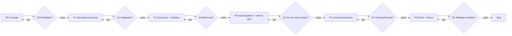
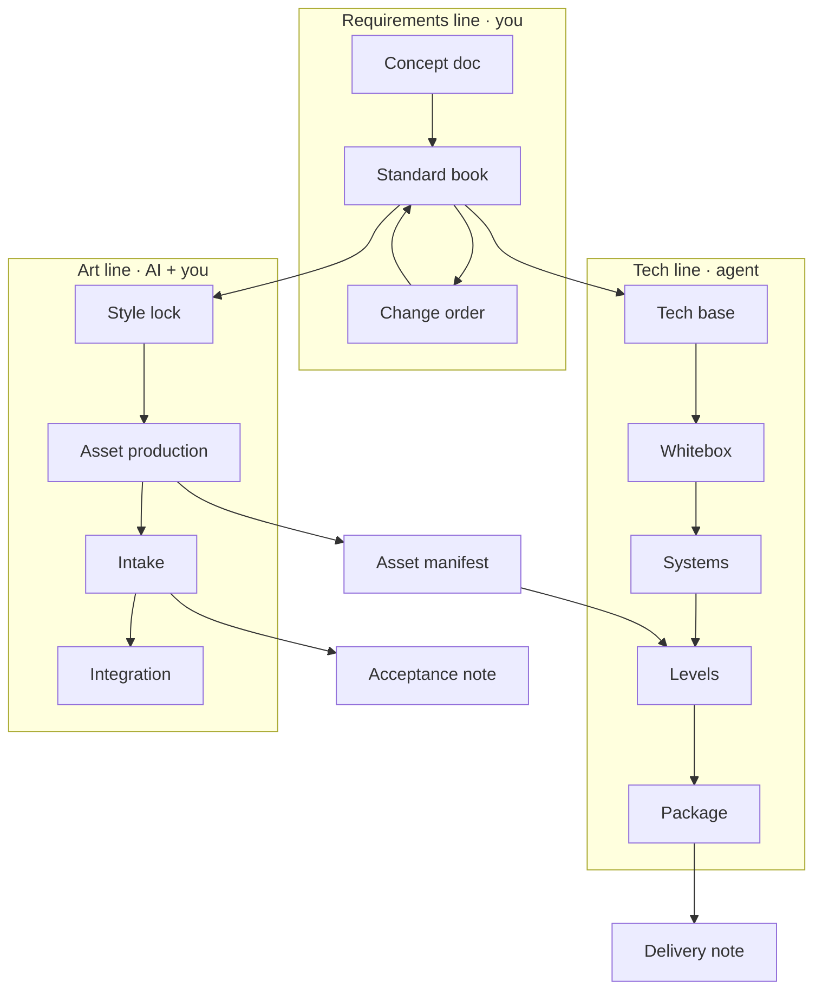

# 00 Overview and Collaboration: How This Workflow Runs

> Stages: P0–P5 ｜ Load when: taking over a project, unsure what comes next, or explaining the overall design to someone ｜ Upstream: none ｜ Downstream: `01-立项.md` → `05-打磨与Demo上线.md`

> **Detailed references and templates are Chinese-first; use SKILL.en.md for routing and translate sections on demand.** The stage names, gate names, decision names and file names below are canonical and must not be translated away.

## What this workflow solves

The biggest risk for a solo developer plus an AI agent is not "cannot build it" — it is **methodically building the wrong thing**. Three typical ways to die:

|Failure|Symptom|Root cause|
|---|---|---|
|Death by documents|A 30-page design doc where not one line says pass or fail|Criterion written as an adjective instead of a test|
|Death by assets|200 assets produced first; the whitebox then proves the loop does not work|Production before validation|
|Death by self-deception|The agent delivers "done" every week; the build is not what you asked for|No evidence on delivery, no record of deviation|

The workflow counters with only three mechanisms:

1. **Each stage has exactly one deliverable.** If the deliverable has the wrong shape, the next stage does not start.
2. **Each stage exit has a judgeable gate** (G0–G5). Gates are not a feeling; they are a command plus a three-second human judgement.
3. **The user makes three kinds of decisions** (requirements / assets / acceptance). Everything else is delegated — but only after the standard book is frozen.

> In one sentence: **turn "making a game" into "passing gates".** Documents are not the goal; gates are.

## Where it fits and where it does not

|Fits|Does not fit|
|---|---|
|1–3 people, including one lead who is not a programmer|Full-time teams of five or more (they need heavier production management)|
|UE5 (5.8+), single-player, Windows first|Online, multiplayer, live-service games|
|One character, 3D, level-based, 3–8 hours of content|Open world, procedural generation, sandbox|
|AI-generated art plus an agent writing code and building levels|Projects that need console certification or a publisher's process|
|A first project at "small" scale (3–5 levels, 12–16 weeks of production plus release buffer)|Commercial scale (20+ levels)|

"Does not fit" does not mean "cannot be adapted"; it means you read the "runaway scope" section of `06-风险与反模式.md` before adapting it.

## Six stages and six gates

|Stage|Weeks|Lead|Core deliverable|Gate|Your time|
|---|---|---|---|---|---|
|**P0 Concept**|Week 1|You + agent|`docs/00_立项书.md`|G0 A stranger can retell it|2 h|
|**P1 Standards and docs**|Weeks 2–3|You + agent|GDD / art bible / tech plan / level list / asset manifest / numbers table|G1 Every criterion judgeable|4 h|
|**P2 Tech base + whitebox**|Weeks 3–6|Agent|Runnable project, greybox level, game-feel parameters, blind-test notes|G2 Blind test passed|2 h|
|**P3 Style lock + asset pipeline + vertical slice**|Weeks 6–12|Agent + you|Style anchor, asset factory, one complete level with boss, UI and audio|G3 A new asset is in-game in 30 minutes|8 h|
|**P4 Content production**|Weeks 13–22|Agent|All levels, enemies, story, collectibles|G4 Full playthrough|12 h|
|**P5 Polish + Demo release**|Weeks 23–28|Agent + you|Performance, localization, store page, Demo|G5 Release checklist|8 h|



The weeks above are a conservative schedule for an agent working 12–16 h per week (about seven months). Using the capacity formula in `01-立项.md`, an agent working 24 h per week lands at roughly 16–20 weeks; trust the computed number and treat this table as an upper bound. On a first project, cut P4 to 3 levels so you get the experience of finishing one full loop.

## Four corrections to the original idea

The original outline (the user's docx) ran: concept → pre-production (concept/art/tech docs) → mid-production (style lock → asset production → intake → integration) → engine work (import assets → build levels → lighting → package) → Demo release. The direction is right, but four points sink beginners. This workflow corrects them:

|#|Original|Correction|Why|
|---|---|---|---|
|1|Asset production before engine work|Whitebox (P2) before mass asset production (P3)|Producing 100 assets before validating the loop means all 100 die with a core loop that is not fun. Do **concept design** early, not mass production|
|2|"Submit every item for review, then move on"|Review the first 20 one by one, then **batches with a 20% sample**|Item-by-item review kills a 3 h/week owner; batch sampling keeps quality while staying affordable|
|3|Think about the Demo only after the game is done|Store page 6 months early; Demo right after the vertical slice|Wishlists take time to accumulate; a Demo is the cheapest way to get real feedback|
|4|Process only, no cost/change/evidence|Add capacity accounting, change orders, delivery and acceptance notes, and a single source of numbers|Agents drift coherently; without evidence and change records you cannot correct the drift|

## What v0.2.0 adds to this loop

|Addition|Where it plugs in|
|---|---|
|Bilingual entry (`README.en.md`, `SKILL.en.md`, this file)|Onboarding and routing for English-speaking owners; Chinese references stay authoritative|
|UE Python asset import (`scripts/ue_import_assets.py`)|P3 asset factory: materials, collision and LOD set from the manifest, not by hand|
|Daily screenshot tour (`scripts/daily_gallery.py`)|Friday review (D3): one page per day instead of scrolling a folder|
|Keyboard & mouse + gamepad|G2 blind test and G5 release: every action on both devices, every menu gamepad-navigable|
|Change order ↔ asset manifest check|Daily `manifest check`: a change that adds or removes assets must reconcile with `docs/05_资产清单.csv`|
|Automated release checks|G5: `gate release` proves what it can from files instead of trusting ticked boxes|
|Multilingual store assets|P5: per-language capsule art, screenshots, trailer and copy in `docs/12_Demo上线清单.md`|

## You make only three kinds of decisions

|ID|Decision|Frequency|Per session|What you get|
|---|---|---|---|---|
|**D1 Requirements**|What to build, what to cut|≤2 times a month|30 min|Concept doc or change order (2–3 options with impact analysis)|
|**D2 Assets**|Pick one of A/B/C|Once a week|45 min|3 candidate sets + comparison sheet + consistency score|
|**D3 Acceptance**|Does an asset or system enter the game|Once a week|30 min|Acceptance note (item-by-item verdict + deviation numbers)|

**Everything else is delegated**: tech plan, code, level building, asset production, slicing and import, testing, packaging, document maintenance.

Three disciplines matter more than the decisions themselves:

1. **Do not enter the editor to fix things mid-week.** Your manual edit conflicts with the agent's work and cannot be traced. Write a change order instead.
2. **Do not read code line by line.** Accept on "does the game show the right behaviour".
3. **Do not change requirements verbally in chat.** Verbal requirements get lost, and a week later the agent builds something you did not ask for. Everything goes into a change order.

## Four pipelines and four interfaces



The lines run in parallel, but only four artefacts need your signature:

|Interface|File|Purpose|Owner|
|---|---|---|---|
|① Standard book|`docs/01`–`docs/03`|The only source of rules and numbers|You freeze it; the agent proposes|
|② Asset manifest|`docs/05_资产清单.csv`|The art-to-tech handover table|Agent maintains, you review|
|③ Delivery note|`docs/07_交付单/`|The only format in which the agent reports to you|Agent|
|④ Acceptance note|`docs/08_验收单/`|Your verdict to the art and systems lines|You (or an agent fills it in, you sign)|

Every argument outside the standard book goes back to the standard book for arbitration. This is the only mechanism that prevents an agent from drifting coherently.

## How to spend 3–4 hours a week

|Slot|Content|Time|
|---|---|---|
|Monday|Approve this week's task cards (≤5, D1)|15 min|
|Wednesday|Asset decision (D2): look at 3 candidate sets, choose, write one line of reasoning|45 min|
|Friday|Screenshot tour + delivery-note acceptance (D3) + next week's goals|45–60 min|
|End of month|Retrospective + scope adjustment + cut list|60 min|

**Why you must show up every week**: stop for two weeks and the agent has probably drifted for two weeks under its own interpretation. Three hours a week is the only correction mechanism in this system. The Friday tour is generated by `scripts/daily_gallery.py`, so reviewing it costs minutes rather than an afternoon.

## Document system

|Layer|File|Nature|Who may change it|
|---|---|---|---|
|Constitution|`01_游戏设计文档` / `02_美术圣经` / `03_技术方案`|Read-only once frozen|Only via a change order|
|Numbers|`06_数值表.csv`|The only source of numbers|Only via a change order|
|Plans|`04_关卡设计/`, `12_Demo上线清单`|Updated with progress|Agent changes, you review|
|Records|`07_交付单/`, `08_验收单/`, `09_变更单/`, `10_测试记录`, `11_周报/`|Append-only, history is never edited|Agent writes|

Three hard rules:

1. **Numbers live in exactly one place.** Every number goes into `06_数值表.csv`; documents reference it instead of repeating it. A document says "jump height, see the numbers table", never "jump height 2.2 m".
2. **When a document and the implementation conflict, change the implementation**, not the document. Changing the document requires a change order.
3. **Every delivery carries evidence**: at least one of screenshot, recording, command output. A delivery note without evidence is rejected outright.

## Gate summary

|Gate|Criterion|Command|If it fails|
|---|---|---|---|
|G0|A stranger can retell it; the core loop closes; scale numbers are self-consistent; the not-doing list has ≥5 items|Human review + `doc check --stage 0`|Back to P0, fix the concept doc|
|G1|Every criterion is machine-checkable or judgeable by eye in 3 seconds; jump numbers are self-consistent; the asset manifest can be reconciled; the tech plan has a performance budget|`gate spec`|Back to P1, delete adjectives and add numbers|
|G2|≥2 of 3 blind testers repeat the core action unprompted; nobody is stuck at the first two checkpoints; greybox holds 60 fps; keyboard & mouse and gamepad both complete the loop|`gate whitebox` + recording|Back to P2, tune game feel or the level|
|G3|An unseen asset goes intake → acceptance → in-level in 30 minutes; style does not drift; the vertical slice is understandable in 60 seconds|`gate assets` + `gate slice`|Back to P3, fix the pipeline|
|G4|Main menu → ending with no blocking bug; every level has a memorable beat; save and settings work; content matches the GDD|`gate content`|Back to P4, fix content|
|G5|Performance on target; store page, achievements, cloud saves, gamepad, localization, crash reporting ready; Demo downloadable; store assets complete in every language|`gate release`|Back to P5, finish the checklist|

The scripts can only verify that **deterministic evidence exists**; they cannot verify that the game is fun or looks good. That judgement is always your D2/D3 decision.

## Project directory

```
<project root>/
├─ docs/                      # All documents, see 02-文档与标准
├─ art/
│  ├─ Source/                 # blend/psd source projects (optionally versioned)
│  ├─ Export/                 # fbx/png/wav exports
│  └─ Inbox/                  # waiting to be imported
├─ assets/                    # Registered final assets ready for UE
├─ game/                      # UE project
├─ scripts/gamecheck.py       # Copied by init; run it inside the project
├─ gamecheck.json             # Project configuration
└─ AGENTS.md                  # Project rules for the agent
```

## Roles and permissions

|Role|Allowed|Forbidden|
|---|---|---|
|You|Decide, accept, playtest, change the standard book (via a change order)|Hand-edit the editor, rewrite code line by line, change requirements verbally|
|Agent|Write code, build whiteboxes and levels, produce and import assets, write docs, run tests|Commit to main directly, delete source assets, upgrade the engine, deliver without evidence, bypass a gate|
|MCP|Read the project, edit the editor, run scripts|Remote access, two clients on the same editor at once, batch renaming (use Python instead)|

## Cost model

Do three calculations before scheduling; if any one overflows, cut scope first:

```
Content hours  = levels × minutes per level            # target 3–5 hours
Art hours      = asset pieces × hours per piece × 1.3  # 1.3 is the rework factor
Weeks available= (total budget hours × 0.6) ÷ hours per week  # 0.6 is slack
```

Suggested ceiling for a first project: 3 levels, 5 enemy types, 1 boss, 30–50 sound effects, 60–120 asset pieces (meshes plus textures; animation frames, materials and other engine-side resources count separately). Above that, finish one complete "small" project first.

## Checklist

- [ ] The project root has `gamecheck.json` and a `docs/` directory
- [ ] The current stage is explicit and the previous gate exits 0
- [ ] The standard book is frozen (freeze date, version, change method recorded)
- [ ] Every number appears once, in `06_数值表.csv`
- [ ] This week has ≤5 task cards, each with acceptance criteria
- [ ] Every delivery note has an evidence link or path
- [ ] The asset manifest and the `assets/` directory match in both directions
- [ ] Change orders record every scope, number and style change made this week
- [ ] All actions work on both keyboard & mouse and gamepad, menus included
- [ ] The weekly report is written: done / blocked / next week / open decisions (≤3)

---

**Languages:** [English](00-overview.md) · [中文](../00-总览与协作.md)
